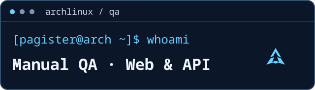
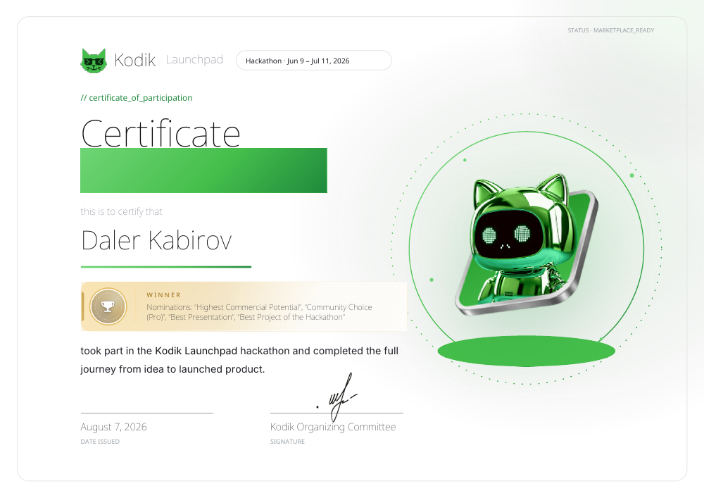

# Далер Кабиров · Daler Kabirov

**Manual QA · Web & API**

Я ручной тестировщик веб-приложений и REST API.

## ReAlgo — мой основной кейс

Я тестировал **ReAlgo** — командный проект для подготовки к алгоритмическим собеседованиям. На хакатоне **Kodik Launchpad** я был единственным QA в команде **Freeburger** из шести человек. Наш проект победил в **четырёх номинациях**.

[Сайт ReAlgo](https://realgo.dev/) · [Репозиторий команды](https://github.com/mxdtrip/realgo)

Я организовал ручное тестирование с нуля: готовил тест-кейсы и чек-листы, проводил smoke, регрессионные и исследовательские проверки. Оформлял баг-репорты в GitHub Issues и проверял исправления.

Что я проверял:

- **Регистрацию и вход** — в том числе валидацию данных.
- **Обновление токенов и сессию** — анализировал запросы и состояние сессии в Chrome DevTools.
- **Ограничение частоты запросов** — проверял поведение REST API при достижении лимита.
- **Браузерное расширение** — повторно проверял исправления.

### Kodik Launchpad

[Winner](certificates/kodik-launchpad-winner.pdf) · [Finalist](certificates/kodik-launchpad-finalist.pdf) · [Shortlist](certificates/kodik-launchpad-shortlist.pdf) · [Participant](certificates/kodik-launchpad-participant.pdf)

## Инструменты

- **API:** Postman, Swagger/OpenAPI.
- **Браузер:** Chrome DevTools.
- **Базы данных:** PostgreSQL, DBeaver, pgAdmin.
- **Задачи и окружение:** GitHub Issues, Docker Compose, Linux. Пользуюсь Arch Linux / CachyOS.

## Сейчас изучаю

Я изучаю **C# и ООП**, пишу учебные приложения на **Windows Forms**.
