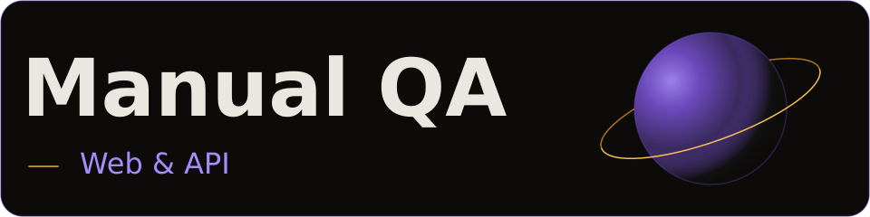
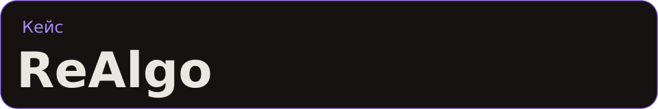
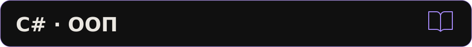

<picture>
  <source media="(max-width: 800px)" srcset="assets/cover-mobile.svg">
  
</picture>

**Manual QA · Web & API** · **[Кейс ReAlgo ↓](#realgo)**

[Сертификаты](#kodik-launchpad) · [Инструменты](#инструменты) · [Сейчас изучаю](#сейчас-изучаю)

## ReAlgo

<picture>
  <source media="(max-width: 800px)" srcset="assets/realgo-mobile.svg">
  
</picture>

Я тестировал **ReAlgo** — командный проект для подготовки к алгоритмическим собеседованиям. На **Kodik Launchpad** я был **единственным QA в команде Freeburger из шести человек**. **Наша команда победила в четырёх номинациях.**

- Я организовал ручное тестирование с нуля: готовил тест-кейсы и чек-листы, проводил smoke, регрессионные и исследовательские проверки.
- Проверял веб-приложение и REST API: регистрацию, вход, обновление токенов, валидацию и лимиты запросов. Анализировал запросы и состояние сессии в DevTools.
- Оформлял баг-репорты в GitHub Issues и проверял исправления, в том числе в браузерном расширении.

**[Сайт ReAlgo](https://realgo.dev/)** · **[Репозиторий команды](https://github.com/mxdtrip/realgo)**

### Kodik Launchpad

**[Winner](certificates/kodik-launchpad-winner.pdf)** · [Finalist](certificates/kodik-launchpad-finalist.pdf) · [Shortlist](certificates/kodik-launchpad-shortlist.pdf) · [Participant](certificates/kodik-launchpad-participant.pdf)

## Инструменты

- **Web и API:** Postman, Chrome DevTools, Firefox DevTools.
- **Базы данных:** PostgreSQL, SQL, DBeaver, pgAdmin.
- **Прокси и Mobile Web:** Charles Proxy — Breakpoints, Map Local, Throttling; мобильные устройства и эмуляторы.
- **Окружение и инфраструктура:** Git, GitHub, Linux, Kafka.

## Сейчас изучаю

<picture>
  <source media="(max-width: 800px)" srcset="assets/learning-mobile.svg">
  
</picture>
