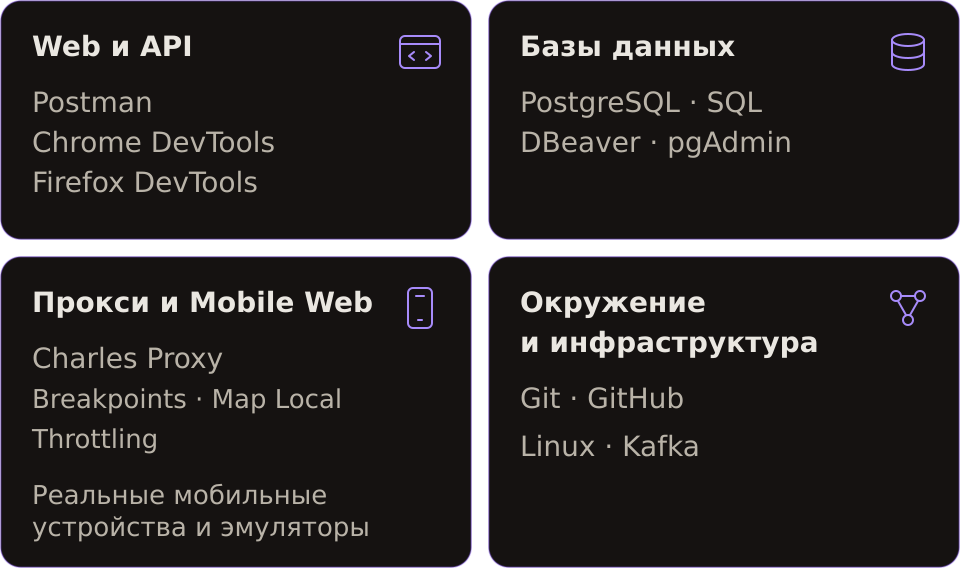

# Daler

<picture>
  <source media="(max-width: 800px)" srcset="assets/cover-mobile.svg">
  
</picture>

  

<table width="100%"><tr><td>

<picture>
  <source media="(max-width: 800px)" srcset="assets/realgo-mobile.svg">
  
</picture>

Я тестировал **ReAlgo** — командный проект для подготовки к алгоритмическим собеседованиям. На хакатоне **Kodik Launchpad** я был единственным QA в команде **Freeburger** из шести человек. Наш проект победил в четырёх номинациях.

**Мой вклад**

- Я организовал ручное тестирование с нуля: готовил тест-кейсы и чек-листы, проводил smoke, регрессионные и исследовательские проверки.
- Проверял регистрацию, вход, обновление токенов, валидацию и ограничение частоты запросов. В DevTools анализировал запросы и состояние сессии.
- Оформлял баг-репорты в GitHub Issues и проверял исправления, в том числе в браузерном расширении.

**[Открыть ReAlgo ↗](https://realgo.dev/)** · **[Репозиторий команды ↗](https://github.com/mxdtrip/realgo)**

</td></tr></table>

### Kodik Launchpad

<table width="100%"><tr>
<td width="48%" align="center" valign="top">

**Winner**

</td>
<td valign="top">

**PDF · EN**

- [Winner](certificates/kodik-launchpad-winner.pdf)
- [Finalist](certificates/kodik-launchpad-finalist.pdf)
- [Shortlist](certificates/kodik-launchpad-shortlist.pdf)
- [Participant](certificates/kodik-launchpad-participant.pdf)

</td></tr></table>

## Инструменты

<picture>
  <source media="(max-width: 800px)" srcset="assets/tools-mobile.svg">
  
</picture>

  

<picture>
  <source media="(max-width: 800px)" srcset="assets/learning-mobile.svg">
  
</picture>

Daler

